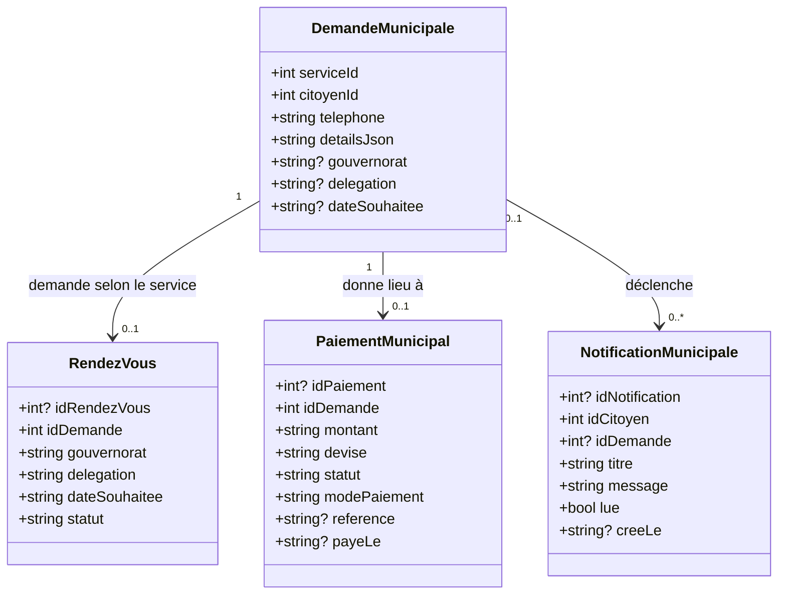

# Entités du module Municipalité

Le diagramme présente exactement les quatre entités demandées : `DemandeMunicipale`, `RendezVous`, `PaiementMunicipal` et `NotificationMunicipale`. Le service et le citoyen sont représentés par leurs identifiants étrangers dans ces entités et ne sont donc pas ajoutés comme classes au diagramme. `RendezVous` possède sa propre table SQL `municipalite_rendez_vous`. Les rendez-vous historiques sont migrés depuis `municipalite_demande` sans suppression des anciennes colonnes.

Une demande peut avoir au plus un rendez-vous et au plus un paiement, conformément aux contraintes uniques de `municipalite_rendez_vous.id_demande` et `municipalite_paiement.id_demande`. Une notification est toujours destinée à un citoyen et peut être liée à une demande. Les reçus d'impression restent générés à partir de la demande et de son paiement : aucune entité d'impression distincte n'est nécessaire.

`RendezVous::fromRow()` construit l'entité depuis sa table dédiée.
