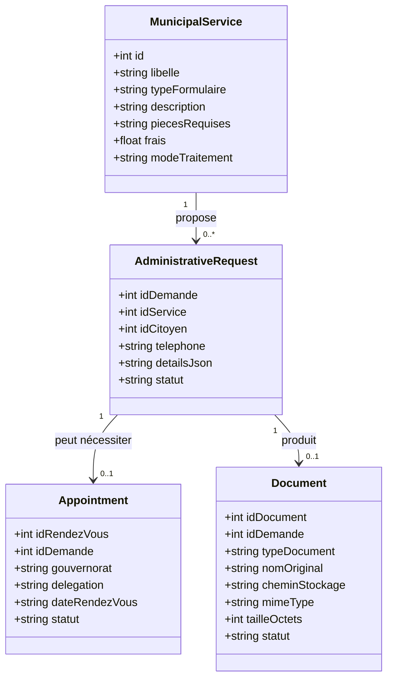

# Entités métier du module Municipalité

La fiche de répartition du projet présente quatre entités métier propres à la Municipalité. Leurs noms dans le code PHP et leurs tables SQL sont :

| Entité du projet | Classe PHP | Table SQL |
|---|---|---|
| MunicipalService | `MunicipaliteService` | `municipalite_service` |
| AdministrativeRequest | `DemandeMunicipale` | `municipalite_demande` |
| Appointment | `RendezVous` | `municipalite_rendez_vous` |
| Document | `DocumentMunicipal` | `municipalite_document` |

Les fonctions Paiement et Notification restent présentes et opérationnelles comme entités transversales supplémentaires. Elles ne remplacent pas les quatre entités municipales indiquées dans la fiche de répartition.

La clé `id_service` relie une demande au service. La clé unique `id_demande` dans la table Document relie au plus un document municipal à sa demande. Le citoyen est référencé par `id_citoyen` dans la demande. La ligne Document est créée avec la demande et son état suit son traitement : en attente, préparation, prêt à retirer ou rejeté. Le chemin d'un éventuel fichier est privé et n'est jamais servi comme URL publique.

La page publique « Municipalité » affiche des raccourcis fonctionnels (consulter les services, suivre ses demandes). Ce ne sont pas des entités de base de données. La liste des services détaillés est dans « Démarches municipales » ; les quatre entités sont celles du modèle et du schéma SQL ci-dessus.
