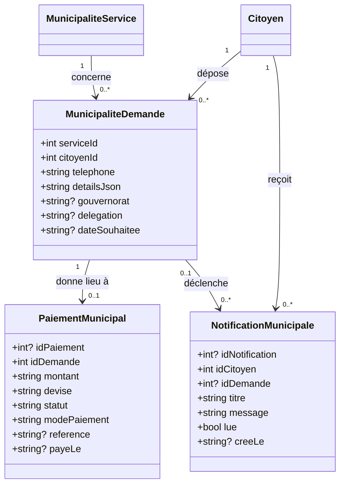

# Entités du module Municipalité

Les entités `PaiementMunicipal` et `NotificationMunicipale` correspondent aux tables dédiées déjà présentes dans `database/municipalite-integration.sql`. Elles complètent le modèle PHP sans remplacer ni modifier les traitements existants.

Une demande peut avoir au plus un paiement, conformément à la contrainte unique de `municipalite_paiement.id_demande`. Une notification est toujours destinée à un citoyen et peut être liée à une demande. Les reçus d'impression restent générés à partir de la demande et de son paiement : aucune entité d'impression distincte n'est nécessaire.
