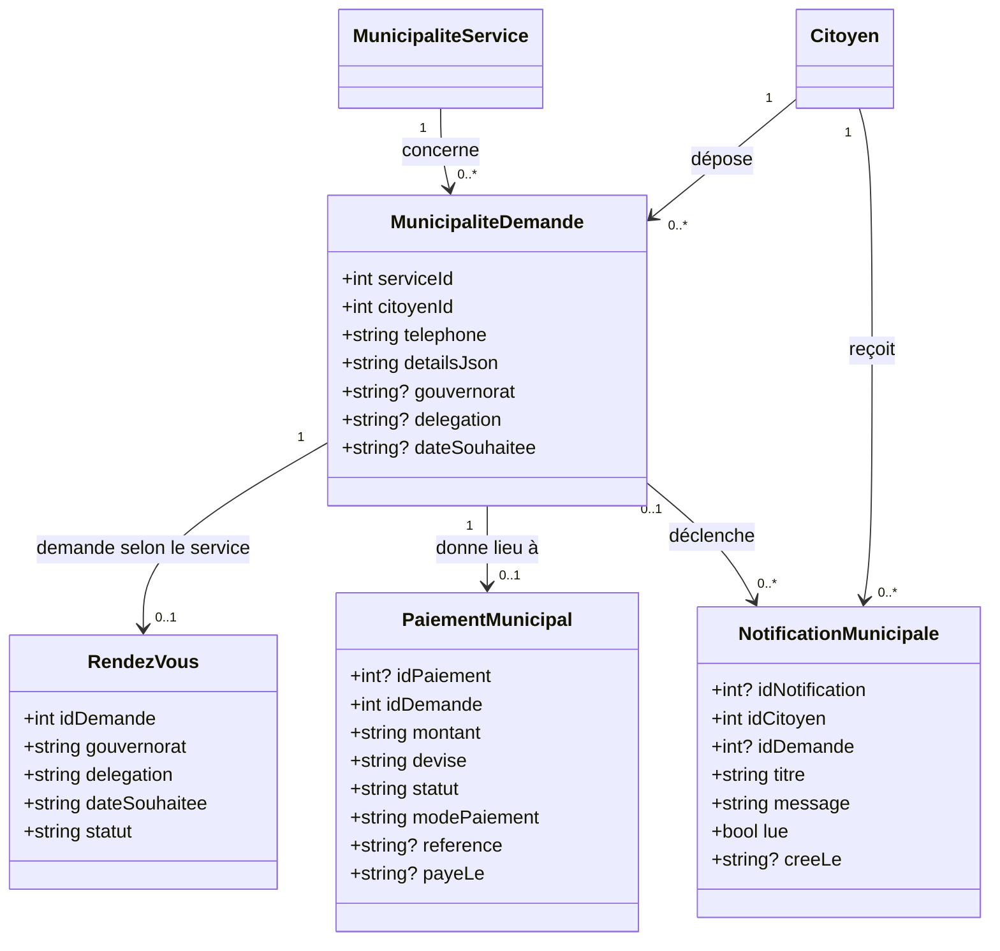

# Entités du module Municipalité

Le module municipalité comporte quatre entités métier : `MunicipaliteDemande`, `RendezVous`, `PaiementMunicipal` et `NotificationMunicipale`. Le rendez-vous est représenté séparément dans le modèle PHP, mais ses colonnes restent stockées dans `municipalite_demande` afin de préserver le schéma et les fonctionnalités actuels. Les paiements et notifications correspondent à leurs tables dédiées déjà présentes.

Une demande peut avoir au plus un paiement, conformément à la contrainte unique de `municipalite_paiement.id_demande`. Une notification est toujours destinée à un citoyen et peut être liée à une demande. Les reçus d'impression restent générés à partir de la demande et de son paiement : aucune entité d'impression distincte n'est nécessaire.

`RendezVous::fromDemandeRow()` construit l'entité lorsqu'une demande contient une date de rendez-vous ; il renvoie `null` pour les demandes qui ne nécessitent pas de déplacement.
